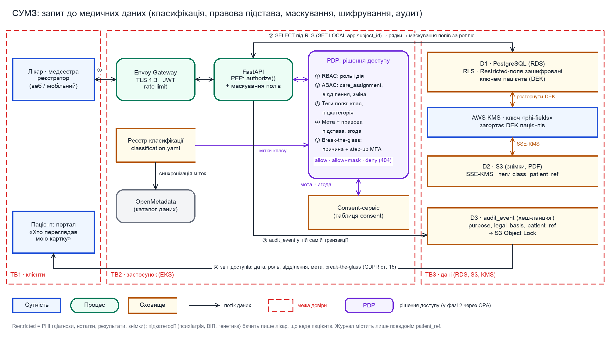

# ДЗ8. Шар захисту даних, класифікації та приватності СУМЗ

| Поле | Значення |
|---|---|
| Дисципліна | Advanced Security Architecture and Engineering (Master of Science: Cyber Security, GoIT Neoversity) |
| Тема | 8. Захист даних і управління класифікацією |
| Студент | Фарід Джафарлі |
| Система | «MedRecordsManager» (СУМЗ): та сама система, що в ДЗ2 (STRIDE, DFD), ДЗ3 (SQUARE), ДЗ5 (ATT&CK → NIST) і ДЗ7 (технічні рішення) |
| Регуляторна рамка | GDPR (дані про здоров’я належать до спеціальної категорії, ст. 9), HIPAA (PHI) як орієнтир для практик, Закон України «Про захист персональних даних» (ст. 7) і лікарська таємниця (ст. 40 Основ законодавства України про охорону здоров’я) |

## Контекст

У ДЗ7 я довів компонент «API Gateway + Backend API» до конкретного стеку: Keycloak з MFA, короткі JWT, authorize() з перевіркою призначення лікар-пацієнт (care_assignment) і Row-Level Security у PostgreSQL, ключі в AWS KMS, журнал аудиту audit_event з хеш-ланцюгом і архівом у S3 Object Lock. Ці рішення відповідають на питання «хто ти і чи можна тобі в систему». У цьому ДЗ я будую наступний шар: які дані лежать у D1-D3, на якій правовій підставі їх обробляють, хто і в якому контексті бачить кожне поле, як довго дані живуть і як їх стирають.

Структуру я взяв з кейсу WTS з теми 8. На рішення ДЗ7 я посилаюся, не переписуючи їх. Строки зберігання і правові підстави тут є інженерною моделлю, остаточно їх затверджує юрист або DPO клініки.



*Рисунок 1. Запит лікаря до медичних даних: де застосовуються класифікація, правова підстава, згода, маскування, шифрування і журнал аудиту.*

## 1. Класифікація даних

Я виділяю шість категорій і чотири рівні чутливості. Від рівня залежить, які контролі обов’язкові. Регуляторні мітки показують, які правові режими діють: згода, строк зберігання, права пацієнта. PHI додатково має мітку підкатегорії (психіатрія, ВІЛ та ІПСШ, генетика, репродуктивне здоров’я, залежності). Такі дані бачить лише лікар, який веде пацієнта, навіть коли інші клінічні дані доступні ширшому колу.

| Категорія | Приклади в СУМЗ | Рівень | Вплив C / I / A | Регуляторні мітки |
|---|---|---|---|---|
| PHI (медичні дані) | Діагнози (МКХ-10), клінічні нотатки, результати аналізів, призначення, знімки й PDF (D2) | Restricted | C: високий · I: високий · A: високий | phi, gdpr-art9, ua-pd-sensitive, medical-secrecy; за потреби subcategory |
| PII (ідентифікаційні дані) | ПІБ, дата народження, телефон, e-mail, адреса, РНОКПП (ІПН), паспорт, страховий поліс | Confidential | C: високий · I: середній · A: середній | gdpr-personal, ua-pd; для РНОКПП і паспорта також national-id |
| Автентифікаційні дані | Хеші паролів, TOTP-секрети, ключі WebAuthn, refresh-токени, ключі KMS і секрети | Restricted (secret) | C: високий · I: високий · A: високий | secret; зберігаються лише в Keycloak, Redis (BFF) і Secrets Manager, не в D1 |
| Журнал аудиту D3 | Хто, коли і до якого запису звертався; рішення доступу | Confidential | C: середній · I: високий · A: середній | audit, gdpr-personal (містить псевдонімний ID пацієнта) |
| Технічні журнали | Логи Envoy, FastAPI, Keycloak у Loki: коди відповідей, trace_id, sub, IP | Internal | C: низький-середній · I: середній · A: низький | ops-log; PHI в них заборонені правилом логування |
| Аналітика і тестові дані | Агрегати (кількість прийомів, завантаження відділень); псевдонімізовані набори для досліджень; синтетичні пацієнти | Internal / Confidential / Public | Агрегати й синтетика: C низький; псевдонімізовані набори: C середній | aggregate; pseudonymized + consent-required; synthetic (pii:false) |

### Як мітки інтегруються в систему

| Де | Як |
|---|---|
| Джерело правди | Файл classification.yaml у репозиторії бекенду. Для кожної таблиці, колонки, API-поля й префікса S3 у ньому задано клас, мітки, підкатегорію, власника (data owner) і політику зберігання. Змінити файл можна лише через PR з обов’язковим рев’ю DPO (CODEOWNERS). |
| База даних (D1) | Міграція Alembic синхронізує файл у таблицю data_classification і в COMMENT ON COLUMN (наприклад, «class=restricted; tags=phi,gdpr-art9»). Модуль authorize() і шар маскування читають класи з цієї таблиці (кеш у пам’яті, скидається при деплої). Restricted-колонки зберігаються зашифрованими (розділ 6). |
| API | Pydantic-поля отримують json_schema_extra={"x-data-class": "restricted", "x-reg": ["phi", "gdpr-art9"]}, тож OpenAPI 3.1 містить розширення x-data-class для кожної властивості. Схеми відповідей за ролями (ДЗ7, К3) будуються з цих міток. |
| Файли (D2) | Теги об’єктів S3: class, patient_ref (псевдонім), retention_until; політика бакета забороняє PutObject без тегу class. |
| Каталог даних | OpenMetadata (open source) отримує схеми PostgreSQL і S3 та мітки з classification.yaml. Через нього DPO й аналітики бачать, де лежать PHI, хто власник і звідки прийшли дані (lineage). Профайлер каталогу шукає неописані колонки й бакети, і кожна знахідка стає задачею на PR у classification.yaml. |
| Контроль у CI | Крок pipeline падає, якщо міграція додає колонку або Pydantic-модель додає поле без запису в classification.yaml (перевірка схеми БД і правило Spectral для OpenAPI на відсутній x-data-class). |

> Джерелом правди я зробив файл у Git, а не каталог. Мітка змінюється разом з кодом, що створює поле, і проходить рев’ю. Каталог показує актуальну картину і знаходить те, що в код не потрапило (наприклад, ручний дамп у S3).

## 2. Правова підстава обробки (legal basis)

Кожен запит до персональних даних має мету обробки (purpose), а кожна мета має задокументовану правову підставу. Реєстр цілей (purpose → підстава → дозволені класи даних → строк зберігання) є машиночитабельною частиною реєстру обробки за ст. 30 GDPR і лежить у тому самому репозиторії, що й classification.yaml. Клієнт не передає мету в довільному заголовку. Її визначає ендпоінт (клінічні маршрути → treatment, експорт для досліджень → research), а authorize() перевіряє, чи дозволена ця мета ролі.

| Мета (purpose) | Правова підстава | Що це означає для системи |
|---|---|---|
| treatment: лікування, діагностика | GDPR ст. 9 (2)(h) + ст. 6 (1)(b); Закон України «Про захист ПД», ст. 7 (обробка медпрацівником, зобов’язаним берегти лікарську таємницю) | Згода не потрібна; доступ лише за призначенням (care_assignment) |
| medical_records: ведення медичної документації, звітність МОЗ | Правовий обов’язок: ст. 6 (1)(c) + ст. 9 (2)(h) | Не можна відкликати; визначає строк зберігання |
| billing: оплата, страхова компанія | Договір: ст. 6 (1)(b) + ст. 9 (2)(h) | Лише реєстратура і бухгалтерія, мінімальний набір полів |
| emergency: невідкладна допомога без призначення | Життєво важливі інтереси: ст. 9 (2)(c) | Лише через break-the-glass з обов’язковим розбором |
| reminders: SMS і e-mail нагадування | Згода: ст. 6 (1)(a) | Перевірка активної згоди перед кожною відправкою |
| research: дослідження, аналітика | Явна згода: ст. 9 (2)(a) | Лише псевдонімізовані набори; виключення тих, хто відкликав |

### Як зберігається згода: таблиця consent

| Поле | Призначення |
|---|---|
| consent_id, patient_id | UUID; patient_id посилається на пацієнта в D1 |
| purpose | Значення з реєстру цілей: reminders, research, marketing… |
| legal_basis | consent або explicit_consent (для ст. 9) |
| status | granted / withdrawn; історія не перезаписується, кожна зміна додається новим рядком |
| notice_version | Версія тексту повідомлення про приватність, яку бачив пацієнт (privacy notice у Git, з тегом релізу) |
| channel, collected_by | Портал, мобільний застосунок або паперова форма; для паперової форми також фіксується, хто з реєстратури її вніс |
| granted_at, withdrawn_at, expires_at | Час надання, відкликання, строк дії (для досліджень це строк проєкту) |
| evidence_hash | SHA-256 від тексту notice, змісту форми і відмітки часу (для паперу від скану). Це доказ згоди за ст. 7 (1) GDPR |

### Як це використовується під час доступу

- Consent-сервіс є модулем бекенду з власною таблицею в окремій схемі D1. Писати в неї може лише цей модуль, читати може authorize().
- Для мети з підставою «згода» authorize() перевіряє активний рядок consent (кеш на 60 с). Для treatment і medical_records згода не перевіряється, але мета мусить відповідати ролі й маршруту.
- Відкликання згоди публікує подію consent.withdrawn (PostgreSQL LISTEN/NOTIFY). Кеш скидається, пацієнта відписують від розсилки в провайдера SMS/e-mail, а наступне вивантаження для досліджень його не бере. Уже видані псевдонімізовані набори позначаються до перегенерації.
- Мета і правова підстава потрапляють у кожен рядок audit_event, тож на запит пацієнта або регулятора можна показати, на якій підставі було кожне звернення.

## 3. Контроль доступу до даних

Доступ вирішується в три шари. RBAC відповідає на питання «що в принципі може ця роль». ABAC відповідає на «чи саме цей пацієнт і чи саме зараз»: активний запис у care_assignment, відділення, зміна. Tag-based control за класом і підкатегорією поля визначає, які поля показати, приховати або замаскувати. Точкою ухвалення рішення (PDP) є модуль authorize() у FastAPI з ДЗ7 (у фазі 2 ті самі правила переходять у OPA/Rego). Точок застосування (PEP) дві: залежність authorize() на кожному маршруті і RLS у PostgreSQL як другий рубіж.

### PoLP і need-to-know за ролями

| Роль | Бачить (need-to-know) | Не бачить / маскується |
|---|---|---|
| Лікар | Повна картка пацієнтів з активним care_assignment; власні записи, призначення, направлення | Пацієнтів без призначення (лише break-the-glass); чужі чернетки нотаток |
| Медсестра | Пацієнти свого відділення на поточній зміні: призначення до виконання, вітальні показники, алергії | Підкатегорії (психіатрія, ВІЛ, генетика) і вільний текст нотаток маскуються |
| Реєстратор | Демографія, контакти, страховка, розклад | Будь-які клінічні поля (у схемі відповіді їх немає) |
| Лаборант | Замовлення аналізів своєї лабораторії, внесення результатів | Історію діагнозів і нотатки |
| Адміністратор | Користувачі, ролі, довідники, конфігурація; метадані без змісту | Медичний зміст; PII, крім ПІБ і логіна працівників |
| Аудитор / DPO | Журнал аудиту, звіти доступу, реєстр згод | Клінічний зміст (доступ лише в межах розслідування, з другим підтвердженням) |
| Пацієнт | Свої записи, свій журнал доступу, свої згоди | Будь-чиї інші дані (чужий запис → 404) |

### Механізми

| Механізм | На чому базується | Як діє |
|---|---|---|
| RBAC | Ролі задаються групами Keycloak, у токені це claim roles | Вмикає набір маршрутів і максимальний клас даних ролі (реєстратор до Confidential, лікар до Restricted) |
| ABAC | authorize(): subject.role, subject.department, subject.shift, resource.patient_id, care_assignment.active_until, purpose | Need-to-know: лікар бачить пацієнта лише з активним призначенням, медсестра бачить лише своє відділення і лише під час зміни |
| Tag-based | Мітки x-data-class і subcategory з classification.yaml | Рішення allow / allow + mask / deny: поле без права заміщується «•••» або відсутнє в схемі; subcategory вимагає, щоб суб’єкт був лікарем, який веде пацієнта |
| RLS | PostgreSQL політики USING з app.subject_id і app.role (ДЗ7, К3) | Навіть помилковий SQL не поверне чужих рядків |
| Break-the-glass | Кнопка «Невідкладний доступ»: причина зі списку + текст, повторна MFA (step-up) | Доступ на 4 год до одного пацієнта, break_glass = true в аудиті, миттєве сповіщення завідувачу й DPO, обов’язковий розбір протягом 24 год, подія видна пацієнту у звіті доступів |

> PoLP для самої системи: роль бекенду не є власником таблиць і не має BYPASSRLS. Розшифрувати Restricted-колонки можна лише ключем, доступним ролі бекенду в KMS (розділ 6), тому адміністратор БД із прямим доступом бачить шифротекст.

## 4. Логування та аудит

В audit_event (ДЗ7, К5) пишеться кожне звернення до даних класу Confidential і вище, у тій самій транзакції, що й читання чи зміна. Туди ж потрапляють усі дії над політиками: зміни ролей, призначень, згод, класифікації, а також break-the-glass і відмови доступу. Медичного змісту, токенів і паролів у журналі немає, лише ідентифікатори. Пацієнта в журналі представляє псевдонім patient_ref, а таблиця відповідності patient_ref ↔ patient_id зберігається окремо. Це знадобиться для права на забуття (розділ 5).

### Що потрапляє в audit trail

- Читання, створення, зміна, експорт, друк запису; зміна результату аналізу з позначкою джерела (лікар чи вебхук лабораторії F8).
- Рішення доступу: allow, allow + mask, deny, з причиною (care_assignment:active, role_forbidden, consent_missing).
- Break-the-glass: причина, тривалість, хто і коли провів розбір.
- Зміни ролей, призначень, класифікації (посилання на PR) і згод (надання, відкликання, notice_version).
- Виконання запитів пацієнтів (DSR): отримано, перевірено особу, виконано або відмовлено з підставою.

### Вигляд запису журналу доступу до чутливих даних

```json
{
  "event_id": "01JB2M7Q4K9V3X8R2T6N5C1D0F",
  "ts": "2026-10-05T09:14:22.481Z",
  "actor": {"sub": "b3f1…", "role": "doctor", "dept": "cardiology", "acr": "webauthn"},
  "action": "read",
  "resource": {"type": "lab_result", "id": "7c2e…", "patient_ref": "pt_9f41…"},
  "data_class": "restricted", "tags": ["phi", "gdpr-art9"],
  "fields": ["value", "interpretation"],
  "purpose": "treatment", "legal_basis": "gdpr_9_2_h",
  "decision": "allow", "reason": "care_assignment:active",
  "break_glass": false, "channel": "web", "ip": "10.12.3.4",
  "trace_id": "4bf92f3577b34da6a3ce929d0e0e4736",
  "prev_hash": "9a1c…", "hash": "e07d…"
}
```

Незмінність забезпечують хеш-ланцюг (prev_hash → hash) і щогодинний експорт у S3 з Object Lock у режимі compliance (ДЗ7). Щоночі окремий job перевіряє ланцюг від останньої контрольної точки, і розрив ланцюга вважається інцидентом.

До запиту пацієнта на доступ до журналу (ст. 15 GDPR; у HIPAA це accounting of disclosures) система готова заздалегідь. На порталі є розділ «Хто переглядав мою картку»: події за останні 12 місяців у реальному часі, з датою, роллю й відділенням, метою і позначкою break-the-glass. Імена працівників за замовчуванням не показуються: за практикою CJEU (справа C-579/21) працівники не є «одержувачами», а їхні дані теж персональні. Якщо пацієнт вважає доступ неправомірним, DPO розкриває деталі в межах розгляду скарги.

Повний звіт за весь строк зберігання пацієнт отримує через запит DSR: PDF із журналу за patient_ref, строк до одного місяця (ст. 12 (3) GDPR). Передачі третім особам (страховій, лабораторії, суду) журналюються як disclosure з одержувачем і підставою й ідуть у звіт окремим розділом.

## 5. Retention і право на забуття

Строки прив’язані до класу і мети, а не до таблиці. Кожен запис при створенні отримує retention_until (з реєстру цілей), а нічний job порівнює дату й запускає дію. Legal hold (скарга, суд, розслідування) ставиться прапорцем на пацієнта і зупиняє будь-яке видалення, доки його не зніме юрист.

| Тип даних | Строк зберігання | Підстава | Що відбувається після строку |
|---|---|---|---|
| Медична документація: картки, діагнози, результати, призначення, знімки (D1, D2) | 25 років після останнього звернення (робоче припущення; строк затверджує юрист за нормами МОЗ і переліком типових документів) | Правовий обов’язок | Криптостирання ключа пацієнта + видалення рядків і об’єктів; об’єкти S3 через 2 роки після створення переходять у Glacier Flexible Retrieval |
| Демографія і контакти | Разом з карткою; контакти для нагадувань зберігаються до відкликання згоди | Договір / згода | Разом з карткою; контакт для розсилок видаляється одразу після відкликання |
| Журнал аудиту D3 | 6 років (орієнтир: вимога HIPAA до документації, 45 CFR 164.316), але не менше строку розслідувань | Правовий обов’язок / законний інтерес | Коли спливає Object Lock, записи видаляються; patient_ref на той час уже ні з ким не пов’язаний (див. нижче) |
| Технічні журнали (Loki) | 90 днів гарячих, 1 рік в архіві S3 | Законний інтерес (безпека) | Lifecycle-правило S3 |
| Згоди і докази до них | Строк обробки + 6 років | Доведення згоди (ст. 7 (1)) | Видалення після строку |
| Псевдонімізовані набори для досліджень | Строк проєкту, максимум 2 роки | Явна згода | Видалення набору і ключа псевдонімізації |
| Агрегати, синтетичні дані | Без обмеження | Не є персональними даними | Не застосовується |
| Резервні копії RDS | Автоматичні 35 днів, щомісячні знімки 12 місяців | Безперервність | Спливають самі; стерті пацієнти нечитабельні через знищений ключ |

### Як виконується запит на видалення

1. Пацієнт подає запит на порталі; особу підтверджує сесія з MFA або візит до реєстратури з документом. Запит отримує запис у таблиці dsr_request зі статусом і строком.
2. DPO оцінює запит. Медичну документацію, яку заклад зобов’язаний зберігати, не видаляють: ст. 17 (3)(b) і (c) GDPR дозволяють відмову через правовий обов’язок і інтереси громадського здоров’я. Замість видалення діє обмеження обробки (ст. 18): запис доступний лише для лікування і на запит уповноважених органів, його виключають з досліджень і аналітики.
3. Те, що зберігати не обов’язково, видаляється одразу: контакти для розсилок, акаунт застосунку, участь у дослідженнях, ідентифікатори в аналітичних наборах. У журналах і наборах даних, які змінювати не можна, дані маскуються через псевдонім.
4. Коли строк зберігання спливає, виконується повне стирання: знищується ключ пацієнта (криптостирання), видаляються рядки D1, об’єкти D2 і запис відповідності patient_ref ↔ patient_id. Після цього записи аудиту з цим patient_ref неможливо пов’язати з людиною.
5. Пацієнт отримує відповідь з переліком виконаного і підставами відмови. Сам факт виконання фіксується в audit_event (deletion_log: метод, дата, виконавець), навіть коли даних уже немає.

### Технічні виклики

| Виклик | У чому проблема | Рішення |
|---|---|---|
| Резервні копії | Із знімка RDS неможливо вибірково видалити рядок | Кожен пацієнт має власний ключ даних (DEK), яким зашифровані його Restricted-поля й файли. Після знищення DEK його дані в усіх копіях стають нечитабельними. Таблиця tombstone (список стертих patient_id) застосовується автоматично після будь-якого відновлення з копії, до повернення БД у роботу. |
| Незмінні журнали | Object Lock у режимі compliance не дозволяє видалити запис до строку | Журнал містить лише псевдонім patient_ref; видалення рядка відповідності знеособлює записи без порушення хеш-ланцюга. |
| Треті сторони | Дані є в LIS лабораторії, у провайдерів SMS і e-mail, у страхової | DPA з кожним обробником містить пункт про видалення за запитом. Worker DSR викликає API видалення провайдера або надсилає формальний запит і зберігає підтвердження в dsr_request. Провайдерам розсилок передається лише телефон/e-mail і текст без діагнозу. |
| Кеші й похідні дані | Redis, PDF-експорти, вивантаження для досліджень | У Redis лише сесії BFF, без PHI; PDF-експорти в D2 живуть 7 днів; набори для досліджень перегенеровуються з урахуванням відкликань. |

## 6. Шифрування й тестування

| Стан даних | Механізм | Навіщо |
|---|---|---|
| At rest | RDS зашифрована ключем KMS для D1, S3 використовує SSE-KMS для D2, для архіву аудиту окремий ключ (ДЗ7, К4). Додатково Restricted-колонки (діагнози, нотатки, результати, підкатегорії) і файли D2 шифруються на рівні полів: envelope encryption через AWS Encryption SDK, окремий DEK на пацієнта, загорнутий ключем KMS «phi-fields». | Шифрування диска захищає від крадіжки носія, але не від адміністратора БД і не від витоку дампу. Шифрування полів закриває й ці випадки, а також дає криптостирання для конкретного пацієнта. |
| In transit | TLS 1.3 на Envoy і HSTS; TLS з перевіркою сертифіката до RDS; HMAC для вебхука лабораторії (ДЗ7). mTLS усередині кластера відкладено на фазу 2, разом із service mesh. | Жоден канал з PHI не йде відкритим текстом, зокрема внутрішній. |
| In use | Мінімізація: розшифрування лише в пам’яті бекенду на час запиту, DEK у кеші не довше 5 хв, PHI не потрапляють у логи, кеші й тексти помилок. | AWS Nitro Enclaves (конфіденційні обчислення) лишаються опцією на майбутнє для аналітики досліджень, у MVP їх немає. |

Розділення ключів: prod, staging і dev живуть в окремих AWS-акаунтах в AWS Organizations. Ключі KMS prod мають key policy лише для ролей prod-акаунта, тому знімок prod, навіть потрапивши в інший акаунт, не розшифрується. Ротація CMK щорічна й автоматична, DEK пацієнта перешифровується при ротації без зміни самих даних.

### Тестування без production-даних

Для dev і staging основні дані синтетичні. Генератор Synthea створює реалістичних пацієнтів з історією хвороб і результатами у форматі FHIR R4, а скрипт імпорту завантажує їх у схему СУМЗ. Кожен набір має мітки synthetic:true, pii:false, версію генератора і seed, щоб тест можна було відтворити.

Якщо для тестів продуктивності потрібна prod-подібна копія, її готує маскувальний pipeline всередині prod-акаунта: відновлення знімка в ізольованій мережі → заміна ПІБ, контактів і РНОКПП на значення Faker, зсув дат на випадкову для пацієнта величину, хешування ідентифікаторів із секретною сіллю, видалення вільного тексту нотаток і файлів → експорт знімка в S3 (Parquet) і сканування Amazon Macie → лише після чистого звіту знімок передається в staging.

### Запобіжники: як prod-дані не потрапляють у dev/test

- Service Control Policy забороняє ділитися знімками й бакетами prod з іншими акаунтами; виняток зроблено лише для ролі маскувального pipeline.
- Розробники отримують доступ до prod лише через break-glass-роль з MFA, обмеженим часом і журналом CloudTrail; постійного доступу немає.
- CI сканує тестові фікстури й дампи в репозиторії (gitleaks для секретів, Microsoft Presidio для ПІБ, телефонів, e-mail, РНОКПП) і падає при знахідці.
- Env-змінні й секрети staging не збігаються з prod; бекенд у staging не має IAM-дозволу на ключі prod.

## Бонус: залишкові ризики

| Ризик | Чому лишається | Як зменшуємо | Відповідальний |
|---|---|---|---|
| Помилка класифікації (нове поле позначене нижчим класом) | Люди помиляються, а профайлер каталогу не бачить сенсу поля | Рев’ю DPO у PR, профайлер OpenMetadata, щоквартальний перегляд класифікації | DPO + техлід |
| Лікар з легітимним призначенням дивиться зайве | Технічно доступ дозволений | Аналітика аудиту (незвичні обсяги, VIP-пацієнти, колеги), вибіркові перевірки, навчання | Завідувачі відділень + DPO |
| Зловживання break-the-glass | Механізм навмисно обходить need-to-know | Обов’язковий розбір за 24 год, звіт по кожному лікарю, дисциплінарні наслідки | Медичний директор |
| Складність керування згодою | Паперові згоди, кілька каналів, зміна текстів notice | Один consent-сервіс для всіх каналів, notice_version, сканування паперу з evidence_hash | Реєстратура + DPO |
| Резервні копії та журнали | Не можна вибірково стерти; відновлення з копії може «повернути» стерте | Криптостирання DEK, tombstone після відновлення, псевдонім у журналі | DevOps |
| Треті сторони | Видалення в LIS чи в провайдера не можна перевірити технічно | DPA, підтвердження видалення, мінімізація переданих даних, аудит обробників | DPO + юрист |
| Компрометація KMS або ролі бекенду | Хто має ключ і роль, той розшифрує все | Розділення ролей, CloudTrail-алерти на Decrypt поза бекендом, окремий акаунт безпеки | Команда безпеки |

## Висновок

Шар захисту даних спирається на рішення ДЗ7 і додає до них чотири речі: мітки класу, які йдуть від classification.yaml у БД, OpenAPI, S3 і каталог; мету й правову підставу в кожному запиті та в кожному рядку аудиту; маскування полів за класом і підкатегорією поверх ABAC; шифрування полів ключем пацієнта. Шифрування полів захищає від адміністратора БД і водночас дає криптостирання в резервних копіях.

Для MVP обов’язкові класифікація з перевіркою в CI, реєстр цілей і consent-сервіс, маскування за ролями, break-the-glass з розбором, розділ «Хто переглядав мою картку», retention_until і legal hold, синтетичні дані замість prod у dev. У фазу 2 можна відкласти OPA, mTLS, маскувальний pipeline (поки вистачає синтетики) і повну автоматизацію видалення в третіх сторін. Криптостирання краще закласти одразу, бо переробляти схему шифрування на наявних даних значно дорожче.

### Звʼязок з попередніми ДЗ

| Елемент ДЗ8 | На що спирається | Що додано |
|---|---|---|
| Класифікація і мітки | ДЗ3: активи A1-A6 і SR-01; ДЗ2: сховища D1-D3 | classification.yaml → data_classification, x-data-class, теги S3, OpenMetadata |
| Правова підстава і згода | ДЗ7: додатковий сценарій GDPR (PT-2, PT-3, PT-4) | Реєстр цілей, consent-сервіс, purpose у кожному запиті |
| Контроль доступу | ДЗ5: загроза 3 (IDOR); ДЗ7: К3 authorize() + RLS | Маскування за класом і підкатегорією, break-the-glass |
| Аудит | ДЗ7: К5 audit_event, хеш-ланцюг, Object Lock | Мета, підстава, клас, patient_ref; звіт пацієнту |
| Retention і право на забуття | ДЗ7: GDPR ст. 17 (3) | retention_until, legal hold, криптостирання, tombstone |
| Шифрування і тестування | ДЗ7: К4 KMS, TLS, HMAC | Шифрування полів з DEK пацієнта, окремі акаунти, Synthea, маскування |

---

Збірка: `python3 draw_data_flow.py` → `NODE_PATH=<node_modules з docx> node build_docx.js` → `node build_md.js`. Файли для здачі: `ДЗ8_Джафарлі_Фарід.docx` (завантажити в Google Docs, відкрити доступ на перегляд) і `ДЗ8_Джафарлі_Фарід.zip`. Нічого не здано, подає студент.
